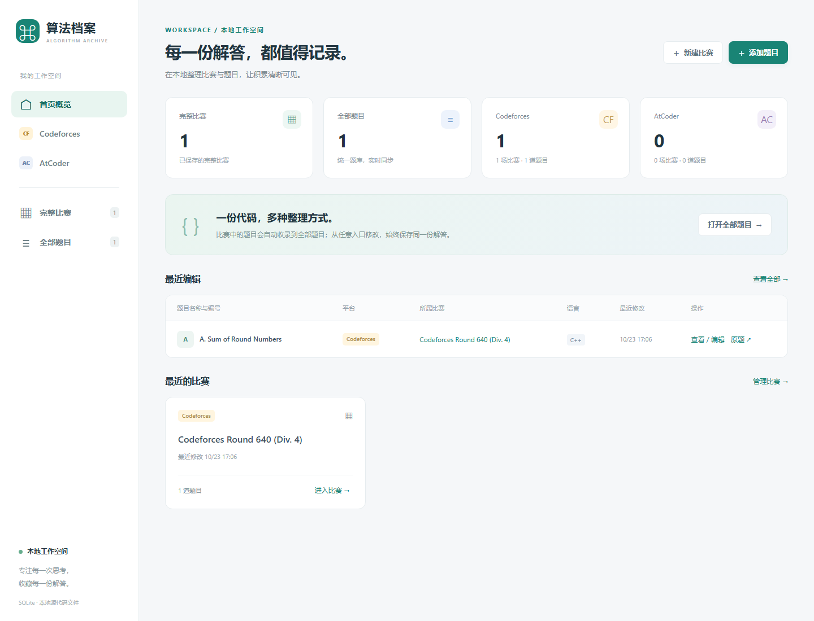
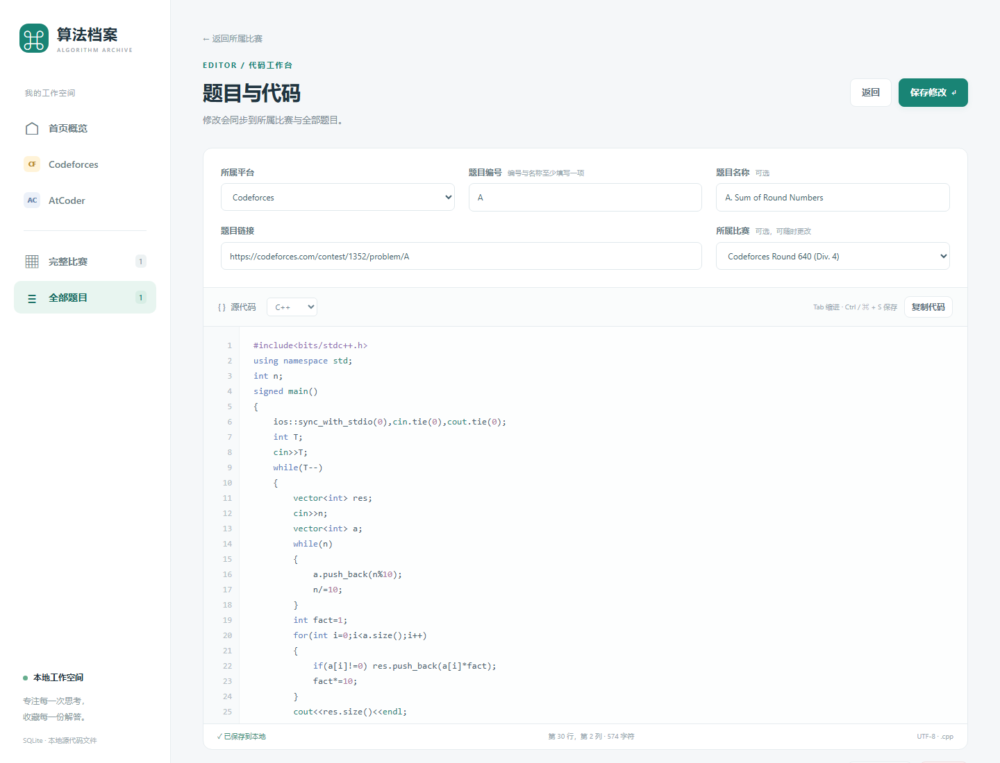

# AlgoArchive · 算法档案

**本地优先的 Codeforces / AtCoder 竞赛题解管理工具**

用一个本地工作空间整理比赛、题目和源代码。记录与代码都保存在当前电脑上，不上传、不自动提交，也不执行代码。

[功能](#功能) · [快速开始](#快速开始) · [界面预览](#界面预览) · [数据与备份](#数据与备份) · [开发与验证](#开发与验证)

## 快速开始

### Windows 发布包

1. 完整解压压缩包，不要直接在压缩包内运行。
2. 双击 `算法竞赛.lnk`，或直接运行 `启动.bat`。
3. 程序会启动本地服务并打开默认浏览器。默认地址为 `http://127.0.0.1:8765`。

使用期间请保留启动窗口。关闭窗口或按 `Ctrl+C` 即停止本地服务。发布包已包含 Windows x64 Python 运行环境，不需要安装 Python、执行 `pip` 或下载前端依赖。

`算法竞赛.lnk` 使用相对目标和相对图标。只要保持目录结构完整并整体移动文件夹，快捷方式可以继续使用。不要只把 `.lnk` 单独移动到桌面，也不要重命名 `启动.bat`、`算法竞赛.ico` 或 `runtime` 目录。

### 在桌面创建快捷方式

完整解压后，双击 `创建桌面快捷方式.bat`。脚本会在当前用户的桌面创建或修复 `算法竞赛.lnk`，并使用项目内的图标、启动文件和工作目录。

如果之后移动了程序目录，请在新位置重新运行一次该脚本，让桌面快捷方式指向新路径。该过程不需要管理员权限，也不会修改系统级设置。

GitHub 下载时请选择下载 ZIP 或克隆完整仓库，不要只单独下载 `.lnk`。如果 Windows 或安全软件阻止了快捷方式，可直接运行 `启动.bat`。

### 从源码运行

需要 Python 3.11 或更新版本，后端和测试只使用 Python 标准库。

```bash
python app.py
```

常用参数：

```bash
python app.py --no-browser
python app.py --port 9000
python app.py --data-dir ./my-archive
```

当指定端口已被占用时，程序会尝试后续可用端口，并在启动窗口中显示实际地址。

## 功能

| 能力 | 说明 |
| --- | --- |
| 比赛归档 | 保存比赛标题、平台和官方链接，进入比赛后逐题添加代码 |
| 统一题库 | 比赛题目与单独添加的题目共享同一条记录和同一份源代码 |
| 平台视图 | 分别浏览 Codeforces、AtCoder 的比赛与题目 |
| 搜索筛选 | 按题目、编号、比赛、平台和代码语言快速定位 |
| 代码工作台 | 支持 C++、Python、Java 和其他文本文件，提供语法高亮、自动缩进、行号与快捷保存 |
| 链接去重 | 标准化官方题目链接，识别 Codeforces 的 `contest` 与 `problemset` 等价地址 |
| 数据安全 | SQLite 元数据与独立源代码文件配合事务、恢复日志和版本冲突检查 |
| 本地运行 | 只监听 `127.0.0.1`，并校验 Host、Origin 和 CSRF 请求头 |

### 代码编辑器

- 使用 `Tab` / `Shift+Tab` 缩进和反缩进。
- 回车会根据当前行自动延续缩进。
- 使用 `Ctrl+S` 保存，macOS 浏览器使用 `Cmd+S`。
- 编辑语言会同步切换源文件扩展名：`.cpp`、`.py`、`.java` 或 `.txt`。
- 单道题目的源代码上限为 2 MiB。

代码编辑器负责整理与保存源码，不包含编译、运行或判题功能。

## 界面预览

### 首页概览

查看比赛、题目和各平台数量，快速进入最近编辑的题目与比赛。



### 题目与代码

在一个页面中维护题目元数据、比赛关联和源代码，保存后同步到所有入口。



界面截图来自本项目的本地实例。

## 使用流程

1. 在首页点击“新建比赛”，填写平台、标题和比赛链接。
2. 进入比赛后点击“添加题目”，粘贴对应题目链接并填写编号或名称。
3. 选择代码语言，粘贴或编写解答，然后保存。
4. 在“全部题目”中按平台、比赛、语言或关键词筛选和查找。
5. 需要备份时，先停止程序，再复制整个 `data` 文件夹。

比赛与题目的平台必须一致。同一道题目最多关联一场已保存比赛；取消关联只会移除比赛关系，不会删除题目或代码。

## 数据与备份

`data/` 目录是完整数据边界，默认结构如下：

```text
data/
├─ archive.sqlite3   # 比赛、题目和关联元数据
├─ codes/            # 实际源代码文件
└─ runtime.lock      # 运行实例锁与本地端口信息
```

源代码按题目唯一 ID 保存，避免题名变化、重名或 Windows 文件名限制导致文件覆盖。数据库只保存元数据和相对文件路径。

**备份**

1. 关闭程序。
2. 复制整个 `data` 文件夹。
3. 恢复时先关闭程序，再用备份完整替换 `data`。

不要只备份 SQLite 数据库，也不要单独替换某个源代码文件，否则可能造成元数据与代码不一致。

## 删除规则

- **取消关联**：保留题目和代码，只移除所属比赛。
- **删除比赛并保留题目**：删除比赛，题目保留在“全部题目”中。
- **删除比赛及题目**：永久删除比赛下的题目记录和源代码文件。
- **删除题目**：永久删除题目记录和源代码文件。

删除操作不能在应用内撤销。执行前请确认重要代码已有独立备份。

## 项目结构

```text
算法竞赛/
├─ app.py                 # 本地 HTTP 服务、数据校验与 SQLite 数据层
├─ 算法竞赛.ico           # Windows 快捷方式图标
├─ 算法竞赛.lnk           # 可随完整文件夹移动的快捷方式
├─ 创建桌面快捷方式.bat   # 为当前解压位置创建桌面快捷方式
├─ web/
│  ├─ index.html          # 页面外壳
│  ├─ app.js              # 路由、交互与代码编辑器
│  └─ style.css           # 界面样式
├─ scripts/
│  └─ create-desktop-shortcut.ps1
├─ runtime/               # Windows x64 内置 Python 环境
├─ data/                  # 运行后生成的本地数据
├─ tests/                 # 后端回归测试
├─ docs/screenshots/      # README 界面截图
├─ .gitattributes         # 保护快捷方式与图标的二进制内容
├─ 启动.bat / start.bat   # Windows 启动入口
├─ 自检.bat               # 在临时目录运行回归测试
├─ TEST_REPORT.md         # 当前交付版本的验证记录
└─ THIRD_PARTY.txt        # 第三方运行环境来源与许可说明
```

后端使用 `http.server`、`sqlite3` 和 Python 标准库；前端是原生 HTML、CSS 和 JavaScript，无构建步骤、CDN 或在线字体依赖。

## 开发与验证

### 运行测试

发布包可直接使用内置运行环境：

```powershell
.\runtime\python.exe .\self_check.py
```

也可以双击 `自检.bat`。测试使用独立临时目录，不读取或修改正式 `data/`。

开发环境中可以运行：

```bash
python self_check.py
```

前端语法检查：

```bash
node --check web/app.js
```

### 当前验证状态

根据 [TEST_REPORT.md](TEST_REPORT.md)，版本 `1.0.0` 的交付记录为：

- Python 标准库回归测试 23 项通过。
- jsdom 前端交互检查 20 项通过。
- `node --check web/app.js` 通过。
- 已覆盖统一题库、链接去重、语言切换、并发冲突、异常恢复、重启持久化和本地请求校验等场景。

自动化测试记录运行于 Linux 的 Python 3.12 与 jsdom 环境。Windows 10 / 11 x64 是目标平台，但当前交付记录不包含完整的 Windows 实机测试；真实浏览器渲染截图已在本次 README 更新中生成并核对。其他操作系统和浏览器组合仍可能暴露未覆盖的问题。

## 已知边界

本版本不包含：

- 在线抓取题目信息或自动同步提交记录。
- 编译、运行、测试或在线判题。
- 代码版本历史、账号系统或云端同步。
- 批量导入、导出或自动备份。

Codeforces / AtCoder 页面链接需要网络才能打开，本地题库管理本身可以离线使用。

## 第三方组件

Windows 发布包内含官方 Windows x64 Python 3.13.9 嵌入式运行环境。来源、版本和许可证详见 [THIRD_PARTY.txt](THIRD_PARTY.txt) 与 `runtime/LICENSE.txt`。
