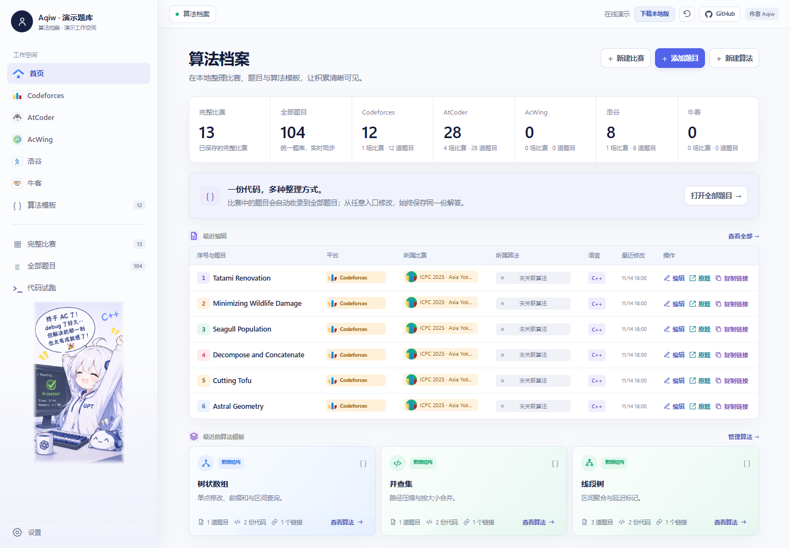
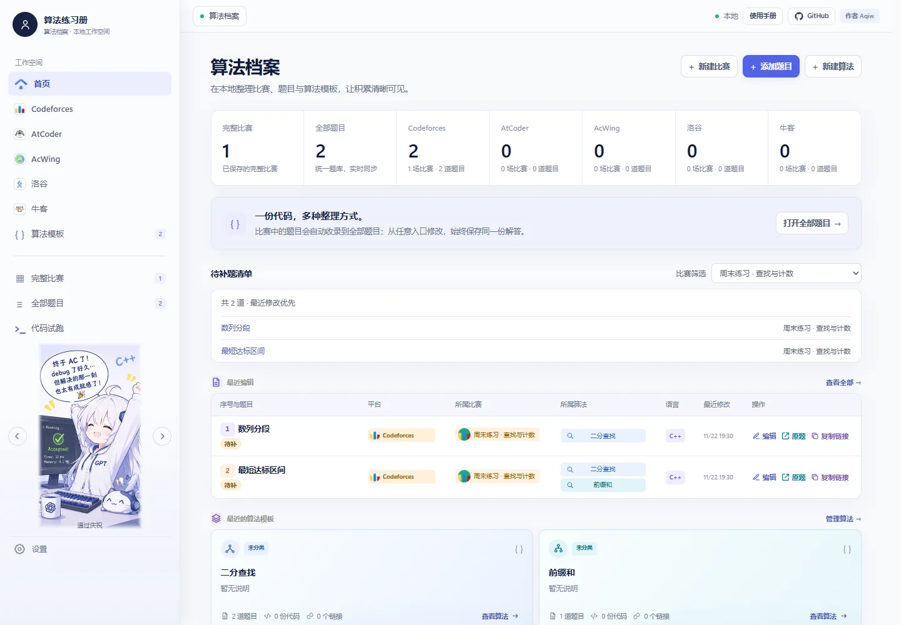
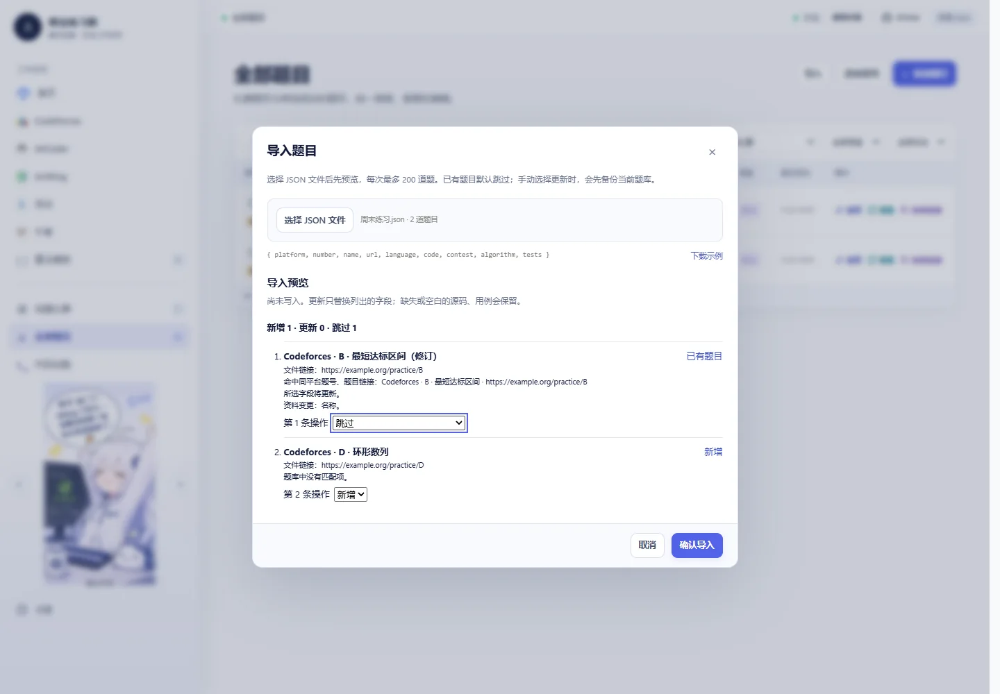
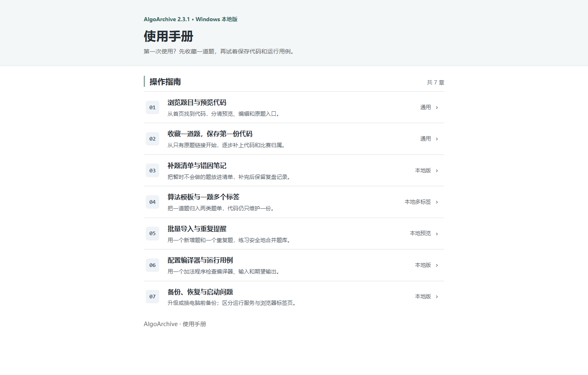
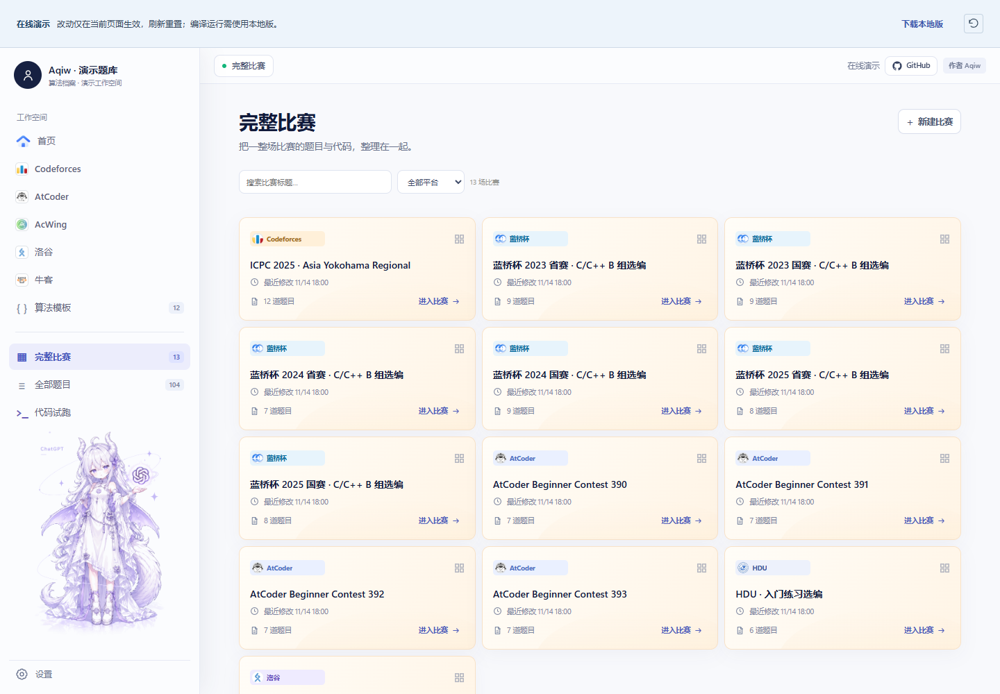
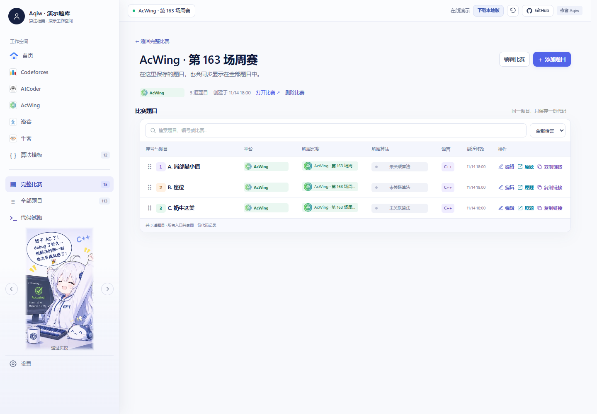
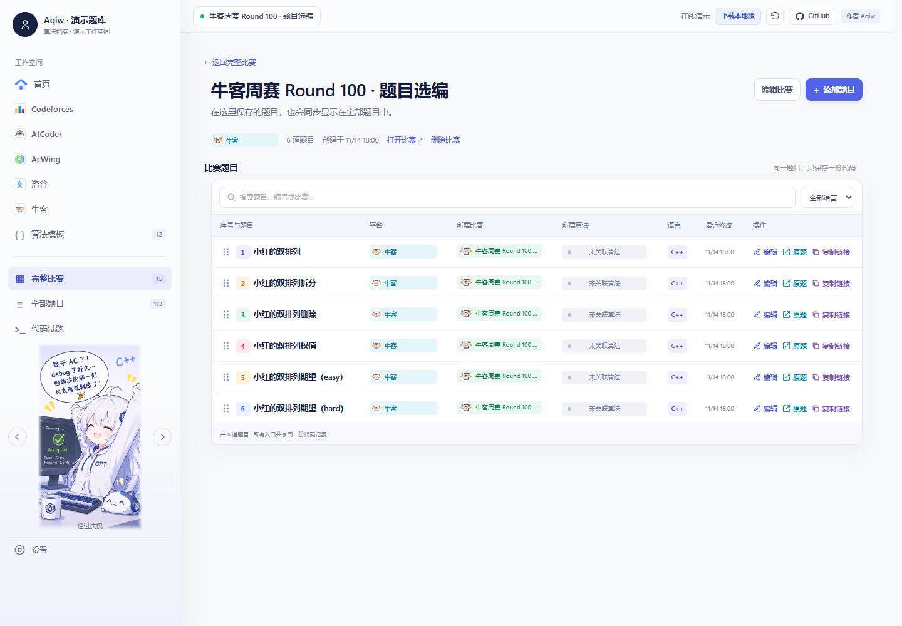
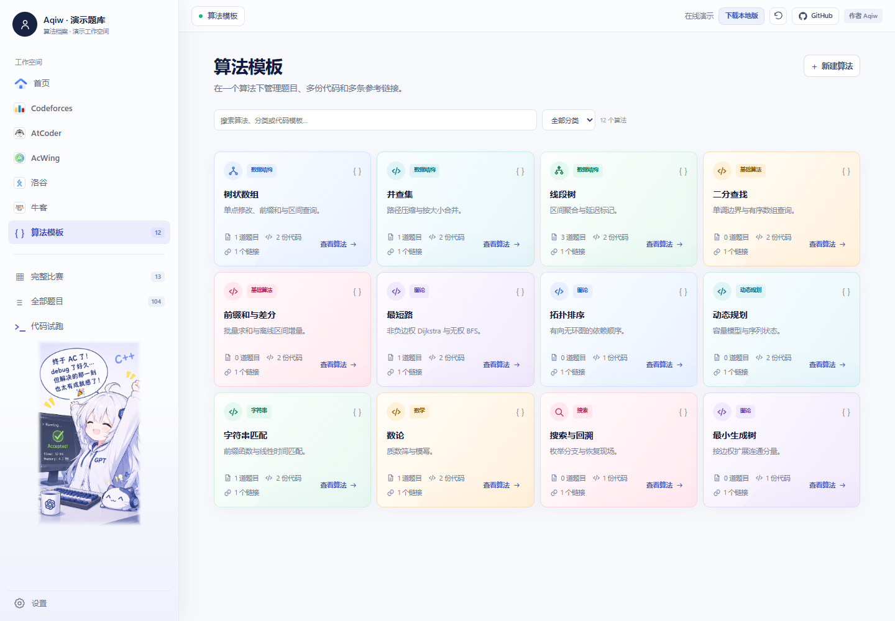
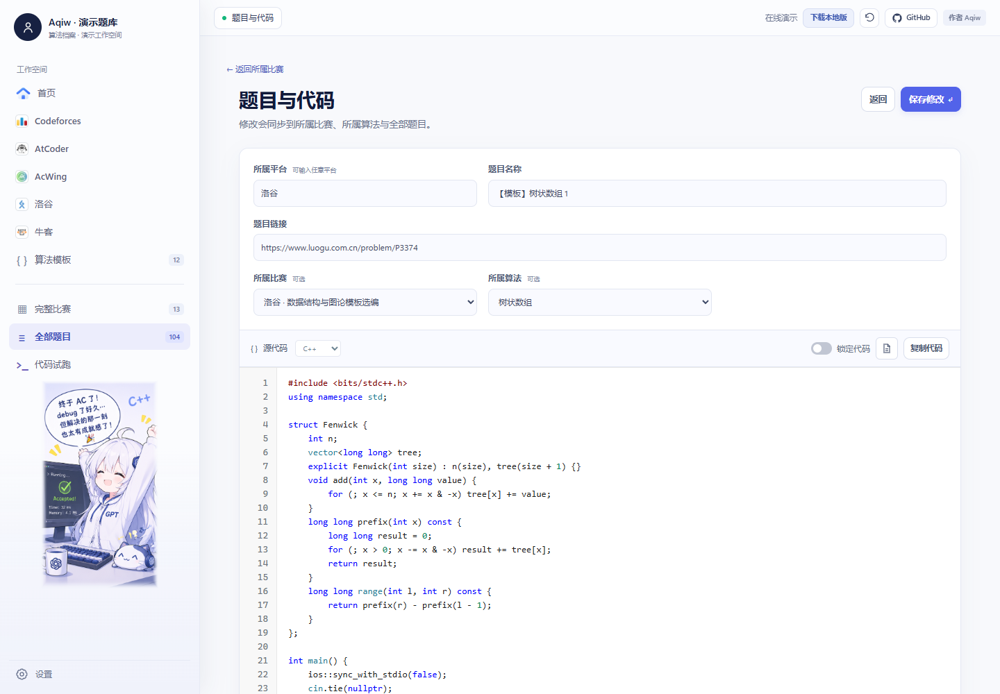
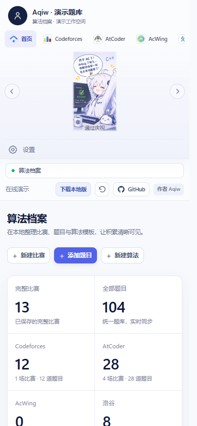

# AlgoArchive · 算法档案

> 当前版本：**2.3.1**。本地版和在线演示都可从右上角打开七章使用手册，本地版支持离线阅读。首页的 Virtual Judge 是第三方网站入口，与本项目无合作关系；请前往该站自行查题或提交。
> 下载与升级说明见下文，具体变更和验证范围见 [CHANGELOG.md](CHANGELOG.md)、[TEST_REPORT.md](TEST_REPORT.md)。

**本地优先的竞赛题解、比赛与算法模板管理工具**

作者：**Aqiw** · [GitHub 仓库](https://github.com/Aqiw-source/AlgoArchive) ·
[下载 Windows x64 版本](https://github.com/Aqiw-source/AlgoArchive/releases/latest)

<a href="https://aqiw-source.github.io/AlgoArchive/"></a>

[浏览演示比赛](https://aqiw-source.github.io/AlgoArchive/#contests) ·
[体验算法模板](https://aqiw-source.github.io/AlgoArchive/#algorithms)

在线演示使用独立数据：15 场比赛或练习选编、113 道题、12 类算法、21 份 C++ 模板，
其中 13 道题目附有完整 C++ 程序和用例。首页「最近编辑」的六道题均可点开查看代码；横滨站 F 题是交互题，附固定交互回放。可以在当前页面编辑、保存和锁定代码，刷新后重置。
编译运行、备份和系统操作需下载本地版；不会连接或修改你的本地题库。
数据来源见 [演示数据说明](https://github.com/Aqiw-source/AlgoArchive/blob/main/demo/SOURCES.md)。

AlgoArchive 使用本地 Python 标准库服务和原生 HTML/CSS/JavaScript 界面。
比赛、题目、算法模板、多份代码、参考链接、头像和设置均保存在当前
Windows 用户的数据目录中，不上传、不自动提交。CPH 兼容测试只会在本机
临时目录中编译并运行当前代码，退出测试后清理临时产物。

> [!IMPORTANT]
> 请下载 Release 中的 `AlgoArchive-2.3.1-Windows-x64-Setup.exe` 或
> `AlgoArchive-2.3.1-Windows-x64.zip`。不要下载 GitHub 自动生成的
> `Source code (zip)` 或 `Source code (tar.gz)`，源码包不包含 Python
> 运行环境，普通用户解压后无法直接启动。

[界面预览](#界面预览) · [功能](#功能) · [安装](#安装) · [数据](#数据与配置) · [备份](#备份与恢复) ·
[浏览器](#浏览器与窗口模式) · [开发](#开发与发布)

## 界面预览

### 首页与本地功能

[](docs/screenshots/dashboard.png)

<details>
<summary>展开 2.3.1 本地版：补题清单、导入预览与离线手册</summary>

以下截图来自单独创建的示例题库。首页可按比赛查待补题；遇到重复导入时，默认跳过已有题。

[](web/guide/media/study.webp)

[](web/guide/media/import.webp)

[](docs/screenshots/local-manual.png)

</details>

### 比赛归档

Codeforces、AtCoder、AcWing、洛谷和牛客提供固定工作空间；平台仍可自由输入，比赛链接也不受限制。
蓝桥杯、HDU、码蹄集、力扣、POJ 在题目和比赛的平台标识中显示官网图标，不增加侧栏工作空间、首页统计或新模块。
题目和比赛的“所属平台”均可展开这 10 个内置平台，搜索或点击填入，也可以手动填写其他平台。

演示中 ICPC 2025 横滨区域赛收录在 Codeforces；蓝桥杯 2023-2025 省赛、国赛选编收录在蓝桥杯。
AcWing 第 163 场周赛和牛客周赛 Round 100 选编只收录题目和原题链接，未附代码文件。

[](docs/screenshots/contests.png)

<details>
<summary>展开 AcWing 与牛客比赛预览</summary>

[](docs/screenshots/acwing-contest.png)

[](docs/screenshots/nowcoder-contest.png)

</details>

### 算法模板

每个算法都可以管理多道题目、多份代码和多个参考链接。

[](docs/screenshots/templates.png)

### 代码工作台

VS Code 风格编辑器，支持行号、语法高亮、`Ctrl+S` 保存和本地源文件备份。

[](docs/screenshots/editor.png)

### CPH 兼容测试

每道题可以保存多组测试用例，使用设置中指定的 g++ 或系统 PATH 中的 g++ 在本机编译运行，
并支持 `.prob` 导入导出。

编译器路径和能力检查位于设置页，实际验证 `__int128`、`multiset` 与
`unordered_map`。

### 代码试跑

侧栏“全部题目”下方的独立工作区，可以快速验证临时 C++ 代码；草稿只在当前
浏览器保存，不会创建题目或进入题库备份。

如果电脑没有 MinGW，程序会直接显示安装说明和“选择 g++ 编译器”按钮，
并跳转到编译器设置，不会只返回一条模糊的运行错误。

### 设置与诊断

浏览器与窗口打开方式可在本地设置中选择，不修改 Windows 全局默认应用。
“侧栏插画”可选择调试报错、优化思路、通过庆祝三张内置图，或隐藏并释放侧栏空间；
侧栏左右箭头手动循环切换，不自动轮播。选择和隐藏状态在本地重启后保留，
恢复默认会显示通过庆祝图。不提供自定义插画上传，头像上传功能不变。

<details>
<summary>展开移动端预览</summary>



</details>

## 功能

| 能力 | 说明 |
| --- | --- |
| 平台工作空间 | 侧栏内建 Codeforces、AtCoder、AcWing、洛谷和牛客入口，统一查看平台比赛与题目 |
| 平台填写建议 | 10 个内置图标平台可搜索、点击填入；仍可自由输入其他平台 |
| 侧栏插画 | 三张内置图手动切换、隐藏或恢复默认；本地保存选择，无自定义上传 |
| 比赛归档 | 平台可自由输入，支持 Codeforces、AtCoder、AcWing、洛谷、牛客和其他完整比赛 |
| 统一题库 | 比赛题目与独立题目共享同一记录和同一份源代码，支持复制原题链接 |
| 补题与复盘（本地） | 手动标记未做、待补或已通过；记录错因，首页按比赛查看待补题 |
| 多算法标签（本地） | 一题可同时出现在多个算法题单，代码、用例和总题数不重复 |
| 导入预览（本地） | 导入前识别重复，已有题默认跳过，核对后逐条决定是否更新 |
| 官网与使用手册（本地） | 平台标题旁打开或复制官网；右上角打开离线手册 |
| 算法模板 | 每个算法可关联多道题目，保存多份代码和多个参考链接 |
| 排序与导入 | 全局题目和算法内题目独立排序，支持逆序和 JSON 批量导入 |
| 代码工作台 | VS Code 风格配色、语法高亮、行号、自动缩进和 `Ctrl+S` 保存 |
| 代码锁定 | 每道题目和每份模板独立设置，默认关闭；锁定后仍可选择、复制和试跑，解锁后编辑 |
| 代码预览 | 弹窗内可全选和复制源码，`Ctrl+A` 只选择代码 |
| 本地评测 | CPH 兼容测试用例、`.prob` 导入导出、单例/全部运行、停止和编译诊断 |
| 代码试跑 | 独立 C++ 草稿、多用例编译运行和浏览器本地保存，不写入题库 |
| 个人资料 | 自定义头像和用户名，头像保存在数据目录 |
| 数据位置 | 默认数据目录、自定义目录、迁移前校验和冲突保护 |
| 浏览器设置 | 系统默认、Edge、Chrome、Firefox 或自定义可执行文件 |
| 完整备份 | 一键 ZIP 备份、导入、恢复、当前数据预备份和路径越界校验 |
| 诊断 | 显示版本、实际地址、数据目录、配置文件和轮转日志路径 |
| 发布自检 | `自检.bat` 检查核心文件、临时数据库、运行环境和可选编译器，不读取用户数据 |
| 本地安全 | 仅监听 `127.0.0.1`，校验 Host、Origin、CSRF 和请求大小 |

## 安装

### 安装程序

发布版提供 Windows x64 安装程序：

1. 运行 `AlgoArchive-2.3.1-Windows-x64-Setup.exe`。
2. 选择“仅为当前用户安装”或“为所有用户安装”。
3. 在安装目录页自由选择程序位置。
4. 仅当“仅为我安装”且当前账户尚无配置时，数据目录页才会出现；此处选择的目录会写入配置。
5. 安装器会创建开始菜单入口；桌面快捷方式可勾选，默认不勾选。

“所有用户安装”不会显示数据目录页，也不会把安装者的个人数据绑定给其他
账户；各账户首次正常启动时使用自己的默认目录。检测到已有
`%USERPROFILE%\AlgoArchive\config.json` 时也会跳过该页，安装器不会覆盖
现有配置。需要更换数据位置时，请启动程序并使用“设置 → 数据管理”迁移。

安装升级会复用既有程序目录并保留用户数据。卸载默认不删除题库、头像、
备份或配置文件。

### 便携 ZIP

1. 完整解压 ZIP，不要在压缩包内直接运行。
2. 双击 `AlgoArchive.exe`。
3. 普通启动不会创建或恢复快捷方式；如有需要，可在“设置 → 关于与诊断”中创建
   桌面和开始菜单入口，或运行 `AlgoArchive.exe --create-shortcut`。
4. 需要检查发布包时，双击 `自检.bat`；自检使用独立临时目录，不访问用户数据。

便携包包含 Windows x64 Python 运行环境，不需要安装 Python、Node、
执行 `pip` 或下载前端依赖。

### 启动行为

程序启动本地服务并打开浏览器。默认地址为：

```text
http://127.0.0.1:8765
```

端口被占用时，程序会选择后续可用端口，启动窗口、关于页和实际打开地址均
使用最终绑定端口。重复启动同一数据目录时，只会唤起已运行实例，不会创建
第二套服务。

使用期间保留启动窗口。关闭窗口、按 `Ctrl+C`，或在“设置 → 关于与诊断”
点击“退出算法档案”都可正常停止服务。普通浏览器标签页关闭不会结束服务。

## 数据与配置

### 路径优先级

数据目录按以下顺序确定：

1. 本次命令明确指定的 `--data-dir <绝对路径>`。
2. 当前用户配置文件中的 `data_dir`。
3. 当前账户默认目录 `%USERPROFILE%\AlgoArchive\data`。

批处理入口不会硬编码或强制传入数据目录。用户配置独立于数据目录，默认位于：

```text
%USERPROFILE%\AlgoArchive\config.json
```

2.0.3 起会兼容旧安装器使用 Windows ANSI/GB18030 写入的配置；新安装器统一写入
UTF-8 无 BOM 配置。中文 Windows 用户名路径不会再导致配置解析失败。

默认数据目录：

```text
%USERPROFILE%\AlgoArchive\data\
```

示例账户可能对应 `C:\Users\Aqiw\AlgoArchive\data`，但代码不会硬编码该用户名
或盘符。其他 Windows 账户使用各自的用户目录。

### 数据目录结构

```text
data/
├─ archive.sqlite3   # 比赛、题目、算法、个人资料和业务设置
├─ codes/            # 题目和算法模板源代码
├─ avatar/           # 头像图片
└─ runtime.lock      # 单实例锁和实际端口信息
```

日志和备份位于数据目录外的用户可写位置：

```text
%USERPROFILE%\AlgoArchive\logs\
%USERPROFILE%\AlgoArchive\backups\
```

自定义数据目录时，对应备份默认放在该数据目录父目录下的 `backups` 文件夹。

### 更换数据位置

在“设置 → 数据管理”输入新的完整数据目录。迁移流程会：

1. 检查目标目录是空目录、残留锁目录、有效数据或不完整数据。
2. 拒绝覆盖有效目标、损坏数据库和不完整目录。
3. 创建当前数据的完整 ZIP 备份。
4. 复制到临时目录，校验 SQLite、比赛/题目/算法和关联代码。
5. 验证成功后写入用户配置，再要求重新启动。

迁移失败时原数据与原配置保持不变。

### 数据库升级

启动先读取数据库 `schema_version`。低于当前版本时，会先创建一致备份再
执行建表、增列或转换。数据库版本高于当前程序支持范围、数据库损坏或代码
文件缺失时，程序拒绝写入并显示错误，不会自动建立新空库覆盖原位置。

### JSON 批量导入

单次最多 200 题。选择 JSON 后先预览：没有匹配的题默认新增，已有题默认跳过。可逐条选择只更新资料，保留现有代码及用例；需要替换时请核对预览列出的变化。更新已有题前会自动创建完整备份。已被其他窗口修改时，需要重新预览。格式无效、批内重复或匹配不唯一的行只可跳过；其余选中变更一起提交。旧客户端直接导入时，整批必须有效且全新。

测试用例的 `input` 和 `output` 均为文本；不识别的顶层字段会提示。

```json
{
  "problems": [
    {
      "platform": "Codeforces",
      "number": "A",
      "name": "示例题目",
      "url": "https://codeforces.com/contest/2000/problem/A",
      "language": "cpp",
      "code": "int main() { return 0; }",
      "tests": [
        {"input": "1\n", "output": "2\n"}
      ]
    }
  ]
}
```

## 备份与恢复

“设置 → 数据管理”提供：

- 一键创建完整 ZIP 备份。
- 恢复本机备份列表中的任意备份。
- 导入其他电脑创建的 ZIP 备份。
- 最多保留最近 20 份应用内备份。

备份至少包含数据库、全部题目和模板代码、头像和业务设置。创建备份时暂停
业务写入，并通过 SQLite 备份 API 生成一致数据库副本。

恢复步骤会先验证 ZIP 路径、文件类型、清单格式、数据库版本和关联代码，
再备份当前数据。恢复失败会回滚到当前数据库和代码目录。

配置文件和浏览器绝对路径不写入备份，避免在另一台电脑恢复时强制套用旧机器
的配置。

## 浏览器与窗口模式

首次默认使用 Windows 默认浏览器，不修改系统全局默认应用。

“设置 → 启动与浏览器”支持：

- 系统默认浏览器。
- Microsoft Edge。
- Google Chrome。
- Mozilla Firefox。
- 自定义本机可执行文件路径。
- 普通标签页。
- Chrome / Edge 独立应用窗口；其他浏览器会说明并回退到标签页。

启动器使用参数数组启动外部进程，不拼接 shell 命令。所选路径失效或启动失败
时，会回退到系统默认浏览器，并在服务仍运行时保留本地地址。

题目原题和算法参考链接继续在外部浏览器的新标签页打开，接受 `http` /
`https` 地址。`example.com/problem/1`、`atcoder.jp` 这类无协议域名会自动
补全为 HTTPS；含空格的备注和 `main.cpp`、`README.md` 等文件名保持不变。

## 代码编辑器

- `Tab` / `Shift+Tab` 缩进和反缩进。
- 回车按当前行自动延续缩进。
- `Ctrl+S` 保存，macOS 风格浏览器使用 `Cmd+S`。
- 支持 C++、Python、Java 和其他文本文件。
- 多行选择采用 VS Code 风格的整行蓝色选区，滚动条使用紧凑灰色样式。
- 单份代码上限为 2 MiB。

编辑器负责保存代码；页面下方的 CPH 测试区可调用本机 g++ 编译和运行用例，不会提交到在线评测。

## 日志与诊断

日志默认写入：

```text
%USERPROFILE%\AlgoArchive\logs\algoarchive.log
```

单文件上限约 1 MiB，保留 3 个轮转文件。日志记录启动、写操作、错误和异常摘要，
隐藏成功静态资源与状态轮询；不记录源代码、数据库内容或完整请求体。

“关于与诊断”显示应用版本、实际服务地址、数据目录、配置文件、数据库版本
和日志路径，并提供复制路径、打开文件夹和退出程序操作。

安装版和便携 ZIP 都包含 `自检.bat`。它只检查发布文件、临时数据库、运行环境和
可选 C++ 编译器，不会读取或修改 `%USERPROFILE%\AlgoArchive\data`。

## 项目结构

```text
AlgoArchive/
├─ app.py
├─ AlgoArchive.exe
├─ start.bat
├─ web/
│  ├─ index.html
│  ├─ app.js
│  ├─ style.css
│  ├─ codex-theme.css
│  ├─ nav-icons/
│  └─ platform-icons/
├─ runtime/
├─ installer/
│  ├─ AlgoArchive.iss
│  └─ ChineseSimplified.isl
├─ scripts/
│  ├─ build-portable.ps1
│  ├─ build-release.ps1
│  └─ verify-release.ps1
├─ tests/
├─ docs/
├─ .github/workflows/windows.yml
├─ CHANGELOG.md
├─ TEST_REPORT.md
├─ LICENSE
├─ DISCLAIMER.md
└─ THIRD_PARTY.txt
```

## 开发与发布

仓库通过 `.gitattributes` 固定换行：Python、JavaScript（含 CJS/MJS）、CSS、HTML
使用 LF，Windows 批处理和 PowerShell 脚本使用 CRLF。便携包在生成校验清单前
规范化这些文件，安装器读取同一份规范化目录；发布检查会拒绝错误或混合换行。

后端需要 Python 3.11 或更新版本，只使用标准库：

```powershell
python -X utf8 -m unittest discover -s tests -v
node --check web/app.js
```

安装 Playwright 并具备 Microsoft Edge 时，可运行真实编辑流程回归：

```powershell
node tests/test_editor_lock.cjs
node tests/test_card_colors.cjs
node tests/test_platform_art.cjs
node --test tests/test_demo.cjs
```

构建便携 ZIP：

```powershell
.\scripts\build-portable.ps1 -Version 2.3.1
```

构建便携 ZIP 和 Inno Setup 安装程序：

```powershell
.\scripts\build-release.ps1 -Version 2.3.1
```

输出位于 `dist/`，并生成对应 `.sha256` 文件。发布包检查会拒绝真实数据库、
用户代码、头像、`runtime.lock`、旧 `.lnk`、备份、缓存和测试目录。

Windows CI 会执行后端测试、前端语法检查、启动器 PE 依赖检查，下载并校验
官方 Python 运行时，然后构建便携包并检查发布包隐私。
版本号、安装器元数据和 Release 标签应在发布时保持一致。

## 当前验证状态

Windows 自动检查涵盖题库读写、导入、备份恢复、编译试跑和 Edge 界面回归。可在 [Windows 验证记录](https://github.com/Aqiw-source/AlgoArchive/actions/workflows/windows.yml) 按提交查看测试结果。历次人工验收及其覆盖范围见 [TEST_REPORT.md](TEST_REPORT.md)。

## 已知边界

本版本不包含：

- 在线抓取题目或同步提交记录。
- 在线提交、在线判题或远程评测。
- Python、Java 等 CPH 非 C++ 运行器；当前本地评测聚焦 C++。
- 代码版本历史、账号系统或云端同步。
- 移动程序文件夹后自动更新快捷方式。便携版移动后，请在新目录运行
  `AlgoArchive.exe --create-shortcut` 或使用设置页重建桌面和开始菜单快捷方式。
  Windows 不允许便携程序可靠地自动固定“开始屏幕”，已有磁贴和任务栏固定项需要在系统中重新固定。

## 许可证

项目自有源代码和自有文档完全开源，采用 [MIT 许可证](LICENSE)，版权归 Aqiw 所有。
平台商标、图标、插画、题目和第三方软件保留各自权利与许可；它们不被重新授予 MIT。

本项目为独立本地工具，不隶属于任何算法平台或 CPH 官方，不表示合作或背书。
CPH 兼容运行器由本项目独立实现，本地测试通过不等于在线评测 Accepted。
详见 [免责声明](DISCLAIMER.md)、[第三方声明](THIRD_PARTY.txt) 和 [资源说明](web/ASSETS.md)。
