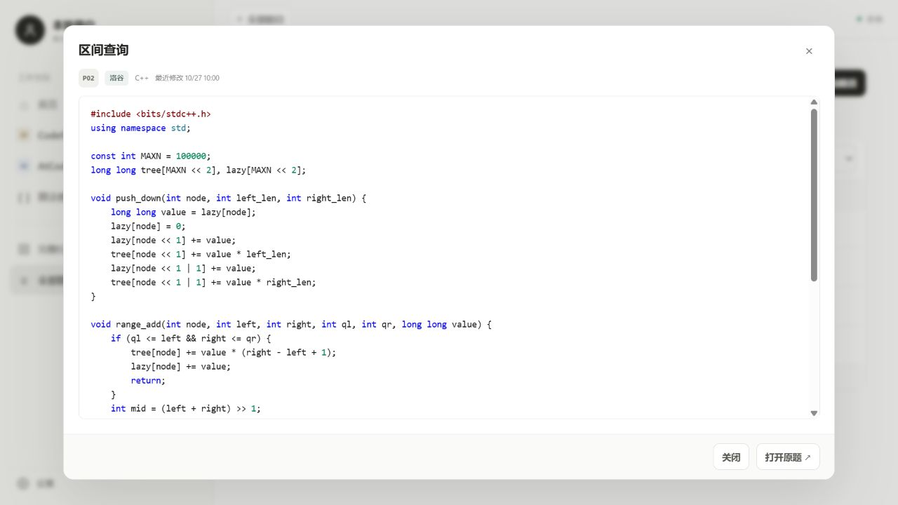

# AlgoArchive · 算法档案

**本地优先的竞赛题解与算法模板管理工具**

[下载 v1.5.1 Windows x64](https://github.com/Aqiw-source/Algorithm/releases/latest)

用一个本地工作空间整理 Codeforces / AtCoder 比赛、题目，以及不依赖平台和比赛的算法模板。记录与代码只保存在当前 Windows 用户的数据目录中，不上传、不自动提交，也不执行代码。

[功能](#功能) · [快速开始](#快速开始) · [界面预览](#界面预览) · [数据与备份](#数据与备份) · [开发与验证](#开发与验证)

## 快速开始

### Windows 发布包

1. 从 [GitHub Releases](https://github.com/Aqiw-source/Algorithm/releases/latest) 下载 `AlgoArchive-Windows-x64-1.5.1.zip`。
2. 完整解压压缩包，不要直接在压缩包内运行。
3. 进入解压后的 `AlgoArchive-Windows-x64\算法档案` 文件夹，运行 `启动.bat` 或 `start.bat`。
4. 如需桌面图标，双击 `创建桌面快捷方式.bat`。
5. 程序会启动本地服务并打开浏览器。默认地址为 `http://127.0.0.1:8765`。

程序会优先使用已安装的 Google Chrome 打开页面；找不到 Chrome 或无法启动时，再使用 Windows 默认浏览器。此行为只影响 AlgoArchive，不修改系统默认浏览器。

用户数据默认保存在：

```text
%LOCALAPPDATA%\AlgoArchive\data\
```

程序目录只保存应用文件。发布源码或安装包时，比赛、题目、算法模板、链接和源代码不会被包含进去。

使用期间请保留启动窗口。关闭窗口或按 `Ctrl+C` 即停止本地服务。发布包已包含 Windows x64 Python 运行环境，不需要安装 Python、执行 `pip` 或下载前端依赖。

发布包不包含带有作者电脑绝对路径的快捷方式。请运行 `创建桌面快捷方式.bat`，脚本会根据当前解压位置生成可用的桌面入口。

### 在桌面创建快捷方式

完整解压后，双击 `创建桌面快捷方式.bat`。脚本会在当前用户的桌面创建或修复 `算法档案.lnk`，并使用项目内的图标、启动文件和工作目录。

如果之后移动了程序目录，请在新位置重新运行一次该脚本，让桌面快捷方式指向新路径。该过程不需要管理员权限，也不会修改系统级设置。

GitHub 主仓库只保存源码和文档，Windows 成品压缩包位于 Releases。开发时可以克隆仓库；普通用户直接下载 Release ZIP 即可。

### 从源码运行

需要 Python 3.11 或更新版本，后端和测试只使用 Python 标准库。

```bash
python app.py
```

常用参数：

```bash
python app.py --no-browser
python app.py --port 9000
python app.py --data-dir ./my-archive
```

当指定端口已被占用时，程序会尝试后续可用端口，并在启动窗口中显示实际地址。

## 功能

| 能力 | 说明 |
| --- | --- |
| 比赛归档 | 保存比赛标题、平台和链接；平台可自由输入，支持洛谷、牛客等其他完整比赛 |
| 统一题库 | 比赛题目与单独添加的题目共享同一条记录和同一份源代码 |
| 算法模板 | 每个算法下可关联多道题目，并保存多份代码模板和多个参考链接 |
| 题目顺序 | 全部题目和算法详情都可拖动排序；全部题目支持一键逆序，两套顺序独立保存 |
| JSON 导入 | 从 JSON 文件批量导入题目、代码、已有比赛标题和算法名称，单次最多 200 道 |
| 个人资料 | 左上角显示当前 Windows 用户名，可从左下角设置头像和自定义用户名 |
| 平台视图 | 左侧固定提供 Codeforces、AtCoder 常用视图；题目和完整比赛仍可保存其他平台 |
| 搜索筛选 | 按题目、编号、比赛、平台和代码语言快速定位 |
| 题目列表 | 点击题目名称打开原题；点击行内空白区域只读预览代码；操作列仅保留“编辑”和“原题” |
| 代码工作台 | 支持 C++、Python、Java 和其他文本文件，提供语法高亮、自动缩进、行号与快捷保存 |
| 题目链接 | 按填写原文保存，不校验域名、协议或链接格式；同一平台下链接原文完全一致时提示已有记录 |
| 数据安全 | SQLite 元数据与独立源代码文件配合事务、恢复日志和版本冲突检查；真实数据默认位于程序目录外 |
| 本地运行 | 只监听 `127.0.0.1`，并校验 Host、Origin 和 CSRF 请求头 |

### 代码编辑器

- 使用 `Tab` / `Shift+Tab` 缩进和反缩进。
- 回车会根据当前行自动延续缩进。
- 使用 `Ctrl+S` 保存，macOS 浏览器使用 `Cmd+S`。
- 编辑语言会同步切换源文件扩展名：`.cpp`、`.py`、`.java` 或 `.txt`。
- 单道题目的源代码上限为 2 MiB。

代码编辑器负责整理与保存源码，不包含编译、运行或判题功能。

## 界面预览

### 首页概览

查看比赛、题目和各平台数量，快速进入最近编辑的题目与比赛。


### 题目与代码

在一个页面中维护题目元数据、比赛关联和源代码，保存后同步到所有入口。


### 算法模板

每个算法可以关联多道题目，并维护多份代码模板和多个参考链接。


### 只读代码预览

点击题目名称打开原题，点击题目行空白区域查看只读代码；操作列只有“编辑”和“原题”。



界面截图来自本项目的本地实例。

## 使用流程

1. 在首页点击“新建比赛”，平台可输入 Codeforces、AtCoder、洛谷、牛客或其他名称，比赛链接可按原文保存。
2. 进入比赛后点击“添加题目”，填写编号或名称；所属平台可自由输入，题目链接可粘贴任意页面地址或先写备注。
3. 选择代码语言，粘贴或编写解答，然后保存。
4. 在“全部题目”中按平台、比赛、语言或关键词筛选和查找；可拖动题目排序、一键逆序，或通过“导入”读取 JSON 文件。
5. 在“算法模板”中创建算法，例如“树状数组”，再为其关联相关题目、添加多份代码和多个参考链接。
6. 在算法详情中按住题目左侧的拖动手柄，把题目拖到目标位置；算法内顺序与全部题目顺序分别保存。
7. 在题目列表中点击题目名称打开原题，或点击该行空白区域只读预览代码；修改代码时使用操作列的“编辑”。
8. 需要备份时，先停止程序，再复制外部 `data` 文件夹。

比赛与题目的平台必须一致。洛谷、牛客等自定义平台比赛可以关联同平台题目，但不会新增到左侧固定平台入口。`Codeforces`、`AtCoder` 名称会按大小写不敏感方式规范为常用平台值，其他平台名称原样保存。同一道题目最多关联一场已保存比赛；取消关联只会移除比赛关系，不会删除题目或代码。

题目列表中的名称、行内空白区域和操作按钮职责分开：名称在新标签页打开原题；空白区域打开只读代码预览，预览只提供关闭和打开原题；操作列只保留“编辑”和“原题”，不会从预览误入编辑状态。

## 数据隐私

GitHub 仓库和 Release 压缩包都不包含 `archive.sqlite3`、`codes/`、`avatar/`、`runtime.lock` 或其他用户数据。首次启动会在当前用户的本地目录创建空数据库。

公开截图使用单独的演示数据，用户名为“本地用户”，不读取正式题库或头像。

## 数据与备份

用户数据目录是完整数据边界，默认位置：

```text
%LOCALAPPDATA%\AlgoArchive\data\
```

目录结构如下：

```text
data/
├─ archive.sqlite3   # 比赛、题目、算法、个人资料和设置
├─ codes/            # 实际源代码文件
├─ avatar/           # 当前头像图片文件
└─ runtime.lock      # 运行实例锁与本地端口信息
```

源代码按题目或代码模板唯一 ID 保存，避免题名变化、重名或 Windows 文件名限制导致文件覆盖。数据库只保存元数据和相对文件路径。

头像会校验为 PNG、JPEG 或 WebP 图片，原始文件上限为 512 KiB；图片保存在 `avatar/` 文件夹，数据库只记录相对路径，自定义用户名保存在 `archive.sqlite3` 的 `settings` 表中。它们不会写入程序目录，也不会随 GitHub 源码或安装包发布。

**备份**

1. 关闭程序。
2. 复制整个 `%LOCALAPPDATA%\AlgoArchive\data` 文件夹。
3. 恢复时先关闭程序，再用备份完整替换该 `data` 文件夹。

不要只备份 SQLite 数据库，也不要单独替换某个源代码文件，否则可能造成元数据与代码不一致。

`--data-dir` 参数仍可指定其他数据目录，适合便携备份或开发测试。

## 删除规则

- **取消关联**：保留题目和代码，只移除所属比赛。
- **删除比赛并保留题目**：删除比赛，题目保留在“全部题目”中。
- **删除比赛及题目**：永久删除比赛下的题目记录和源代码文件。
- **删除题目**：永久删除题目记录和源代码文件。
- **删除代码模板**：只删除当前模板和对应文件，保留所属算法与其他代码。
- **删除算法**：永久删除该算法、全部链接、全部代码模板和对应源代码文件。

删除操作不能在应用内撤销。执行前请确认重要代码已有独立备份。

## 项目结构

```text
算法档案/
├─ app.py                 # 本地 HTTP 服务、数据校验与 SQLite 数据层
├─ ACM-ICPC-Windows.ico   # Windows 软件图标
├─ 创建桌面快捷方式.bat   # 根据当前解压位置创建桌面入口
├─ web/
│  ├─ index.html          # 页面外壳
│  ├─ app.js              # 路由、交互与代码编辑器
│  ├─ style.css           # 基础界面样式
│  └─ codex-theme.css     # Codex 风格覆盖样式
├─ scripts/
│  └─ create-desktop-shortcut.ps1
├─ tests/                 # 后端回归测试
├─ docs/screenshots/      # README 界面截图
├─ .gitattributes         # 保护图标与其他二进制文件
├─ .gitignore             # 排除数据库、用户源码和运行数据
├─ 启动.bat / start.bat   # Windows 启动入口
├─ 自检.bat               # 在临时目录运行回归测试
├─ TEST_REPORT.md         # 当前交付版本的验证记录
└─ THIRD_PARTY.txt        # 第三方运行环境来源与许可说明
```

Release 压缩包还会包含 `runtime/`，用于在未安装 Python 的 Windows 10 / 11 x64 电脑上直接运行。

后端使用 `http.server`、`sqlite3` 和 Python 标准库；前端是原生 HTML、CSS 和 JavaScript，无构建步骤、CDN 或在线字体依赖。

## 开发与验证

### 运行测试

发布包可直接使用内置运行环境：

```powershell
.\runtime\python.exe .\self_check.py
```

也可以双击 `自检.bat`。测试使用独立临时目录，不读取或修改正式用户数据。

开发环境中可以运行：

```bash
python self_check.py
```

前端语法检查：

```bash
node --check web/app.js
```

### 当前验证状态

根据 [TEST_REPORT.md](TEST_REPORT.md)，版本 `1.5.1` 的交付记录为：

- Python 标准库回归测试 59 项通过。
- `node --check web/app.js` 通过。
- 已覆盖统一题库、算法多代码与多链接、全部题目与算法内独立排序、JSON 批量导入、个人资料持久化、任意比赛与题目平台、数据库升级、外部数据迁移、并发冲突、异常恢复、重启持久化和本地请求校验等场景。

自动化测试运行于 Windows 的 Python 3.12。桌面与移动视口均已使用本机 Chrome 完成自定义比赛和题目保存、链接原文保存、筛选显示、控制台错误和布局溢出检查。

## 已知边界

本版本不包含：

- 在线抓取题目信息或自动同步提交记录。
- 编译、运行、测试或在线判题。
- 代码版本历史、账号系统或云端同步。
- 导出或自动备份。

比赛和题目页面链接需要网络才能打开，本地题库管理本身可以离线使用。

## 第三方组件

Windows 发布包内含官方 Windows x64 Python 3.13.9 嵌入式运行环境。来源、版本和许可证详见 [THIRD_PARTY.txt](THIRD_PARTY.txt) 与 `runtime/LICENSE.txt`。
