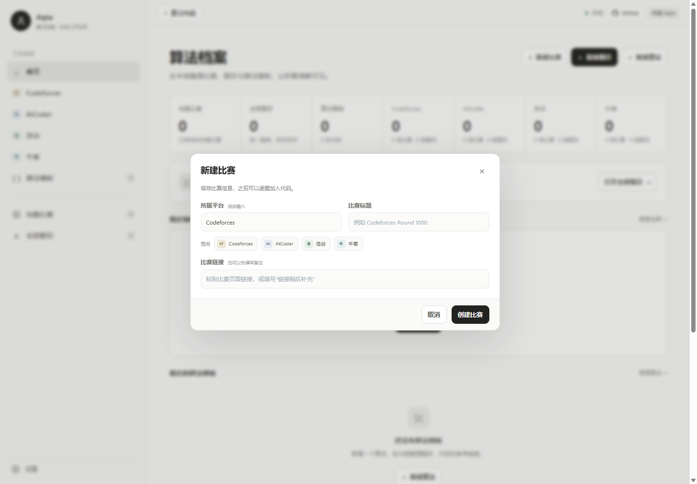
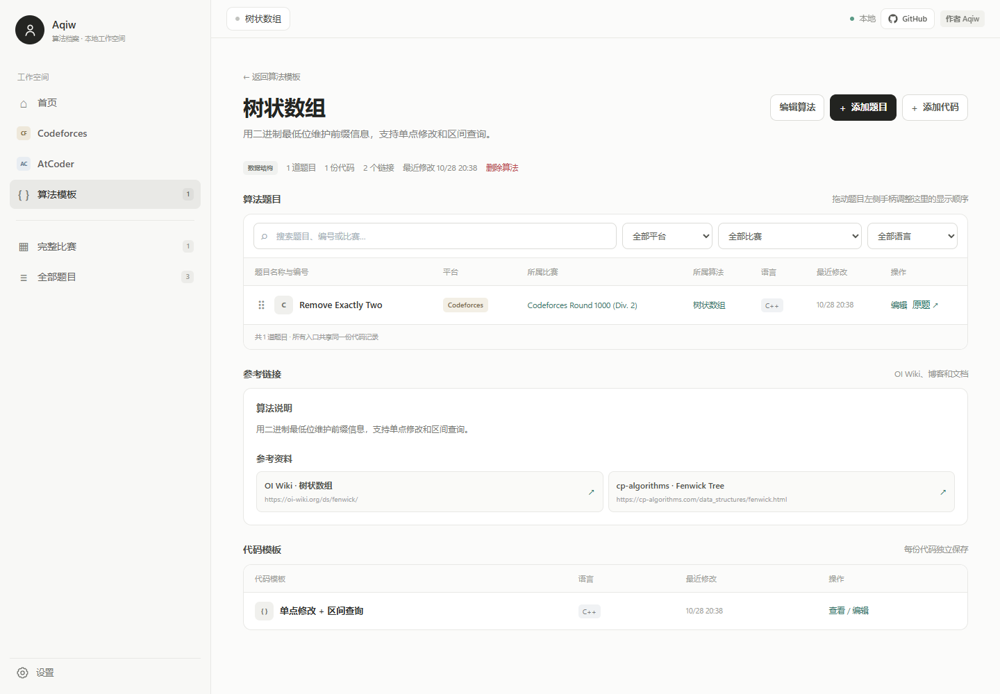
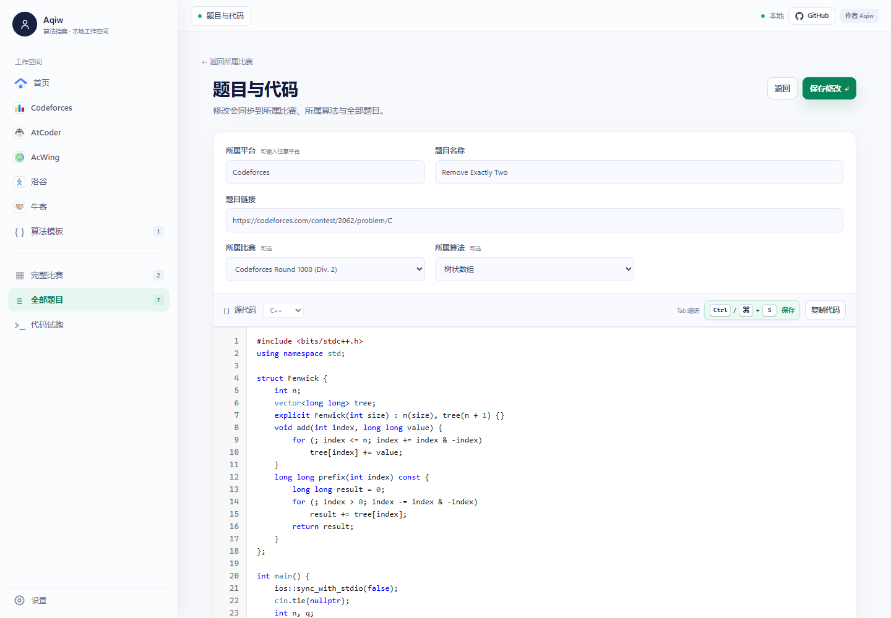
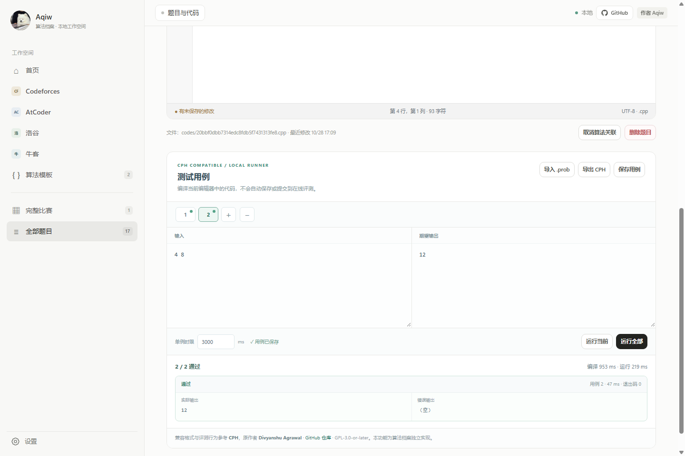
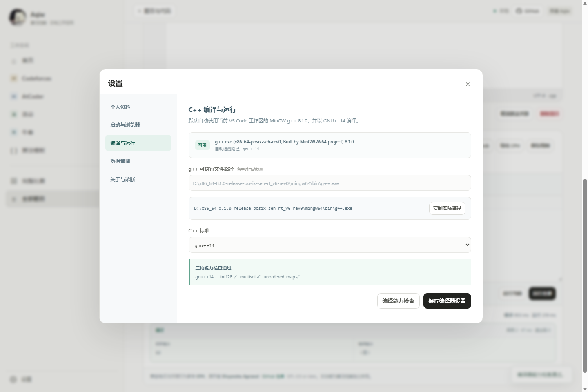
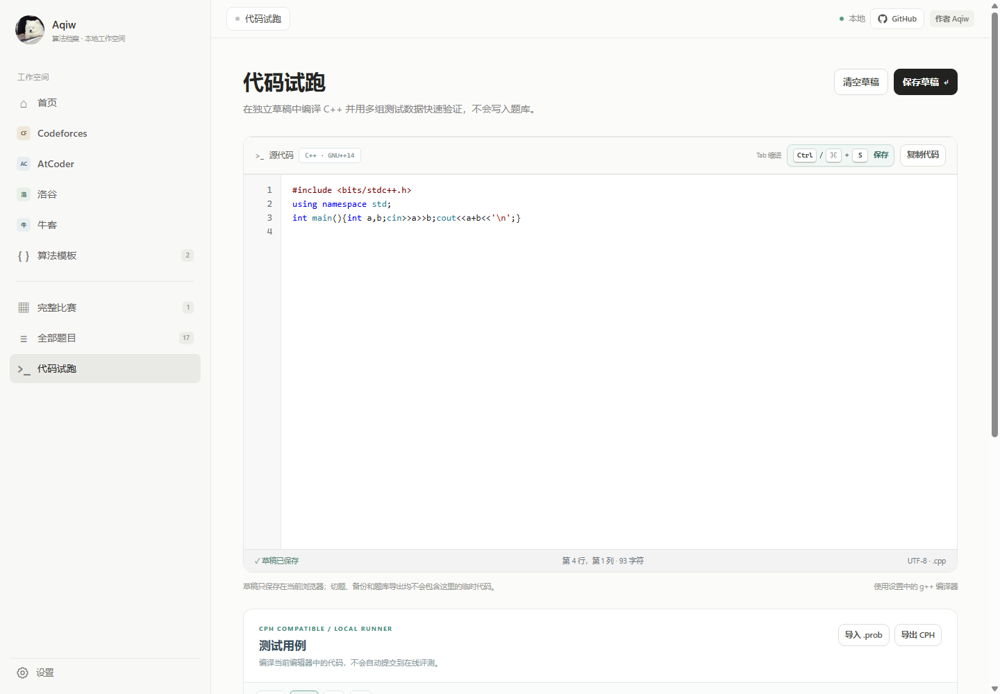
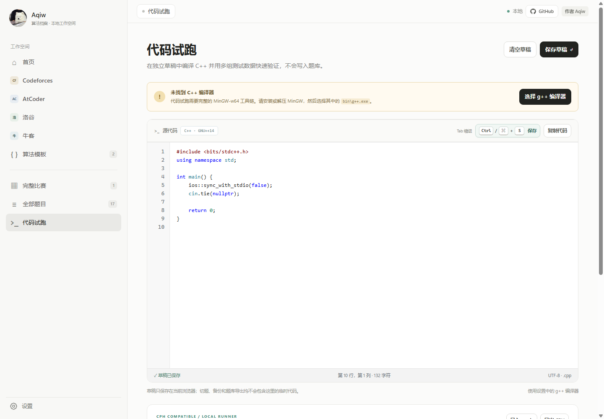
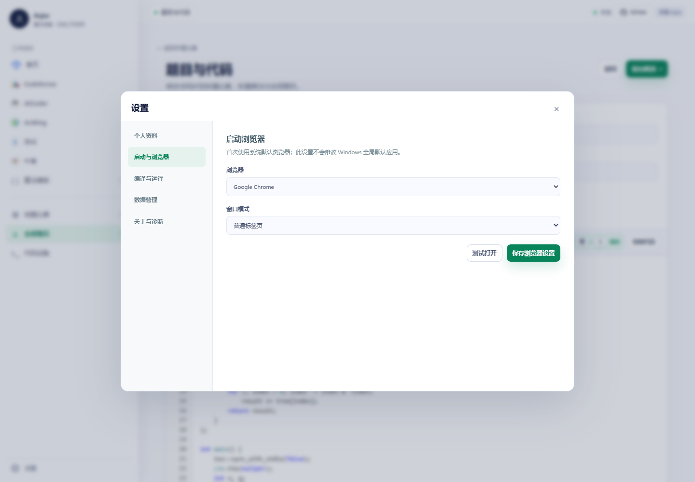

# AlgoArchive · 算法档案

**本地优先的竞赛题解、比赛与算法模板管理工具**

作者：**Aqiw** · [GitHub 仓库](https://github.com/Aqiw-source/AlgoArchive) ·
[下载 Windows x64 版本](https://github.com/Aqiw-source/AlgoArchive/releases/latest)

AlgoArchive 使用本地 Python 标准库服务和原生 HTML/CSS/JavaScript 界面。
比赛、题目、算法模板、多份代码、参考链接、头像和设置均保存在当前
Windows 用户的数据目录中，不上传、不自动提交。CPH 兼容测试只会在本机
临时目录中编译并运行当前代码，退出测试后清理临时产物。

> [!IMPORTANT]
> 请下载 Release 中的 `AlgoArchive-2.1.3-Windows-x64-Setup.exe` 或
> `AlgoArchive-2.1.3-Windows-x64.zip`。不要下载 GitHub 自动生成的
> `Source code (zip)` 或 `Source code (tar.gz)`，源码包不包含 Python
> 运行环境，普通用户解压后无法直接启动。

[界面预览](#界面预览) · [功能](#功能) · [安装](#安装) · [数据](#数据与配置) · [备份](#备份与恢复) ·
[浏览器](#浏览器与窗口模式) · [开发](#开发与发布)

## 界面预览

### 本地工作空间


### 比赛归档

Codeforces、AtCoder、洛谷和牛客提供固定工作空间；平台仍可自由输入，比赛链接也不受限制。



### 算法模板

每个算法都可以管理多道题目、多份代码和多个参考链接。



### 代码工作台

VS Code 风格编辑器，支持行号、语法高亮、`Ctrl+S` 保存和本地源文件备份。



### CPH 兼容测试

每道题可以保存多组测试用例，使用当前 VS Code 的 MinGW g++ 在本机编译运行，
并支持 `.prob` 导入导出。



编译器路径和能力检查位于设置页，实际验证 `__int128`、`multiset` 与
`unordered_map`。



### 代码试跑

侧栏“全部题目”下方的独立工作区，可以快速验证临时 C++ 代码；草稿只在当前
浏览器保存，不会创建题目或进入题库备份。



如果电脑没有 MinGW，程序会直接显示安装说明和“选择 g++ 编译器”按钮，
并跳转到编译器设置，不会只返回一条模糊的运行错误。



### 设置与诊断

浏览器与窗口打开方式可在本地设置中选择，不修改 Windows 全局默认应用。



## 功能

| 能力 | 说明 |
| --- | --- |
| 平台工作空间 | 侧栏内建 Codeforces、AtCoder、洛谷和牛客入口，统一查看平台比赛与题目 |
| 比赛归档 | 平台可自由输入，支持 Codeforces、AtCoder、洛谷、牛客和其他完整比赛 |
| 统一题库 | 比赛题目与独立题目共享同一记录和同一份源代码 |
| 算法模板 | 每个算法可关联多道题目，保存多份代码和多个参考链接 |
| 排序与导入 | 全局题目和算法内题目独立排序，支持逆序和 JSON 批量导入 |
| 代码工作台 | VS Code 风格配色、语法高亮、行号、自动缩进和 `Ctrl+S` 保存 |
| 本地评测 | CPH 兼容测试用例、`.prob` 导入导出、单例/全部运行、停止和编译诊断 |
| 代码试跑 | 独立 C++ 草稿、多用例编译运行和浏览器本地保存，不写入题库 |
| 个人资料 | 自定义头像和用户名，头像保存在数据目录 |
| 数据位置 | 默认数据目录、自定义目录、迁移前校验和冲突保护 |
| 浏览器设置 | 系统默认、Edge、Chrome、Firefox 或自定义可执行文件 |
| 完整备份 | 一键 ZIP 备份、导入、恢复、当前数据预备份和路径越界校验 |
| 诊断 | 显示版本、实际地址、数据目录、配置文件和轮转日志路径 |
| 本地安全 | 仅监听 `127.0.0.1`，校验 Host、Origin、CSRF 和请求大小 |

## 安装

### 安装程序

发布版提供 Windows x64 安装程序：

1. 运行 `AlgoArchive-2.1.3-Windows-x64-Setup.exe`。
2. 选择“仅为当前用户安装”或“为所有用户安装”。
3. 在安装目录页自由选择程序位置。
4. 仅当“仅为我安装”且当前账户尚无配置时，数据目录页才会出现；此处选择的目录会写入配置。
5. 完成安装，桌面快捷方式会自动创建。

“所有用户安装”不会显示数据目录页，也不会把安装者的个人数据绑定给其他
账户；各账户首次正常启动时使用自己的默认目录。检测到已有
`%USERPROFILE%\AlgoArchive\config.json` 时也会跳过该页，安装器不会覆盖
现有配置。需要更换数据位置时，请启动程序并使用“设置 → 数据管理”迁移。

安装升级会复用既有程序目录并保留用户数据。卸载默认不删除题库、头像、
备份或配置文件。

### 便携 ZIP

1. 完整解压 ZIP，不要在压缩包内直接运行。
2. 双击 `启动.bat`。
3. 首次启动会自动创建桌面快捷方式；也可以运行 `创建桌面快捷方式.bat` 手动刷新。

便携包包含 Windows x64 Python 运行环境，不需要安装 Python、Node、
执行 `pip` 或下载前端依赖。

### 启动行为

程序启动本地服务并打开浏览器。默认地址为：

```text
http://127.0.0.1:8765
```

端口被占用时，程序会选择后续可用端口，启动窗口、关于页和实际打开地址均
使用最终绑定端口。重复启动同一数据目录时，只会唤起已运行实例，不会创建
第二套服务。

使用期间保留启动窗口。关闭窗口、按 `Ctrl+C`，或在“设置 → 关于与诊断”
点击“退出算法档案”都可正常停止服务。普通浏览器标签页关闭不会结束服务。

## 数据与配置

### 路径优先级

数据目录按以下顺序确定：

1. 本次命令明确指定的 `--data-dir <绝对路径>`。
2. 当前用户配置文件中的 `data_dir`。
3. 当前账户默认目录 `%USERPROFILE%\AlgoArchive\data`。

批处理入口不会硬编码或强制传入数据目录。用户配置独立于数据目录，默认位于：

```text
%USERPROFILE%\AlgoArchive\config.json
```

2.0.3 起会兼容旧安装器使用 Windows ANSI/GB18030 写入的配置；新安装器统一写入
UTF-8 无 BOM 配置。中文 Windows 用户名路径不会再导致配置解析失败。

默认数据目录：

```text
%USERPROFILE%\AlgoArchive\data\
```

示例账户可能对应 `C:\Users\Aqiw\AlgoArchive\data`，但代码不会硬编码该用户名
或盘符。其他 Windows 账户使用各自的用户目录。

### 数据目录结构

```text
data/
├─ archive.sqlite3   # 比赛、题目、算法、个人资料和业务设置
├─ codes/            # 题目和算法模板源代码
├─ avatar/           # 头像图片
└─ runtime.lock      # 单实例锁和实际端口信息
```

日志和备份位于数据目录外的用户可写位置：

```text
%USERPROFILE%\AlgoArchive\logs\
%USERPROFILE%\AlgoArchive\backups\
```

自定义数据目录时，对应备份默认放在该数据目录父目录下的 `backups` 文件夹。

### 更换数据位置

在“设置 → 数据管理”输入新的完整数据目录。迁移流程会：

1. 检查目标目录是空目录、残留锁目录、有效数据或不完整数据。
2. 拒绝覆盖有效目标、损坏数据库和不完整目录。
3. 创建当前数据的完整 ZIP 备份。
4. 复制到临时目录，校验 SQLite、比赛/题目/算法和关联代码。
5. 验证成功后写入用户配置，再要求重新启动。

迁移失败时原数据与原配置保持不变。

### 数据库升级

启动先读取数据库 `schema_version`。低于当前版本时，会先创建一致备份再
执行建表、增列或转换。数据库版本高于当前程序支持范围、数据库损坏或代码
文件缺失时，程序拒绝写入并显示错误，不会自动建立新空库覆盖原位置。

## 备份与恢复

“设置 → 数据管理”提供：

- 一键创建完整 ZIP 备份。
- 恢复本机备份列表中的任意备份。
- 导入其他电脑创建的 ZIP 备份。
- 最多保留最近 20 份应用内备份。

备份至少包含数据库、全部题目和模板代码、头像和业务设置。创建备份时暂停
业务写入，并通过 SQLite 备份 API 生成一致数据库副本。

恢复步骤会先验证 ZIP 路径、文件类型、清单格式、数据库版本和关联代码，
再备份当前数据。恢复失败会回滚到当前数据库和代码目录。

配置文件和浏览器绝对路径不写入备份，避免在另一台电脑恢复时强制套用旧机器
的配置。

## 浏览器与窗口模式

首次默认使用 Windows 默认浏览器，不修改系统全局默认应用。

“设置 → 启动与浏览器”支持：

- 系统默认浏览器。
- Microsoft Edge。
- Google Chrome。
- Mozilla Firefox。
- 自定义本机可执行文件路径。
- 普通标签页。
- Chrome / Edge 独立应用窗口；其他浏览器会说明并回退到标签页。

启动器使用参数数组启动外部进程，不拼接 shell 命令。所选路径失效或启动失败
时，会回退到系统默认浏览器，并在服务仍运行时保留本地地址。

题目原题和算法参考链接继续在外部浏览器的新标签页打开，只接受可由浏览器
打开的 `http` / `https` 地址。

## 代码编辑器

- `Tab` / `Shift+Tab` 缩进和反缩进。
- 回车按当前行自动延续缩进。
- `Ctrl+S` 保存，macOS 风格浏览器使用 `Cmd+S`。
- 支持 C++、Python、Java 和其他文本文件。
- 单份代码上限为 2 MiB。

编辑器只管理代码，不编译、运行或判题。

## 日志与诊断

日志默认写入：

```text
%USERPROFILE%\AlgoArchive\logs\algoarchive.log
```

单文件上限约 1 MiB，保留 3 个轮转文件。日志记录启动、请求路由和异常摘要，
不记录源代码、数据库内容或完整请求体。

“关于与诊断”显示应用版本、实际服务地址、数据目录、配置文件、数据库版本
和日志路径，并提供复制路径、打开文件夹和退出程序操作。

## 项目结构

```text
AlgoArchive/
├─ app.py
├─ 启动.bat / start.bat
├─ 创建桌面快捷方式.bat
├─ web/
│  ├─ index.html
│  ├─ app.js
│  ├─ style.css
│  └─ codex-theme.css
├─ runtime/
├─ installer/
│  ├─ AlgoArchive.iss
│  └─ ChineseSimplified.isl
├─ scripts/
│  ├─ build-portable.ps1
│  ├─ build-release.ps1
│  └─ verify-release.ps1
├─ tests/
├─ docs/
├─ .github/workflows/windows.yml
├─ CHANGELOG.md
├─ TEST_REPORT.md
├─ LICENSE-PENDING.md
└─ THIRD_PARTY.txt
```

## 开发与发布

后端需要 Python 3.11 或更新版本，只使用标准库：

```powershell
python -X utf8 -m unittest discover -s tests -v
node --check web/app.js
```

构建便携 ZIP：

```powershell
.\scripts\build-portable.ps1 -Version 2.1.3
```

构建便携 ZIP 和 Inno Setup 安装程序：

```powershell
.\scripts\build-release.ps1 -Version 2.1.3
```

输出位于 `dist/`，并生成对应 `.sha256` 文件。发布包检查会拒绝真实数据库、
用户代码、头像、`runtime.lock`、旧 `.lnk`、备份、缓存和测试目录。

Windows CI 会执行后端测试、前端语法检查，下载并校验官方 Python 运行时，
然后构建便携包并检查发布包隐私。
版本号、安装器元数据和 Release 标签应在发布时保持一致。

## 当前验证状态

详见 [TEST_REPORT.md](TEST_REPORT.md)。本次版本 2.1.3 已验证：

- 隔离后端测试全部通过。
- `node --check web/app.js` 通过。
- CPH 面板、多用例、`.prob` 导入导出、本地运行和编译器诊断在桌面及
  390px 移动视口正常，无控制台错误和横向溢出。
- 便携 ZIP 成功生成并通过发布内容与隐私检查。

真实用户数据不会在自动化测试中使用。

## 已知边界

本版本不包含：

- 在线抓取题目或同步提交记录。
- 在线提交、在线判题或远程评测。
- Python、Java 等 CPH 非 C++ 运行器；当前本地评测聚焦 C++。
- 代码版本历史、账号系统或云端同步。
- 系统性修改程序目录后修复所有外部入口；便携版移动目录后应重新运行快捷
  方式创建工具。

## 许可证

项目维护者尚未选择发行许可证。详见
[LICENSE-PENDING.md](LICENSE-PENDING.md)。第三方运行环境和语言文件保留各自
许可，记录于 [THIRD_PARTY.txt](THIRD_PARTY.txt)。
